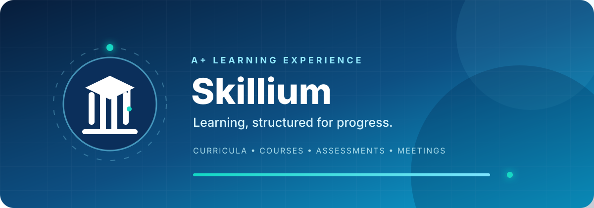
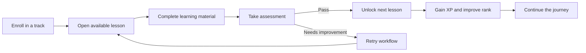
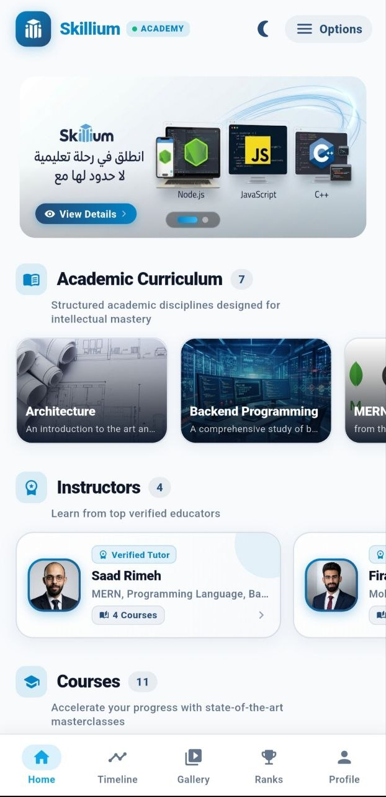
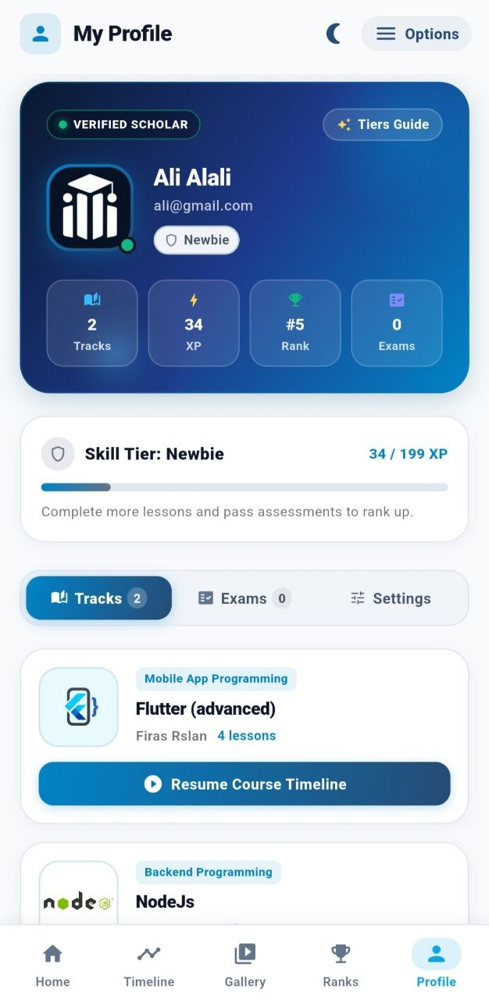
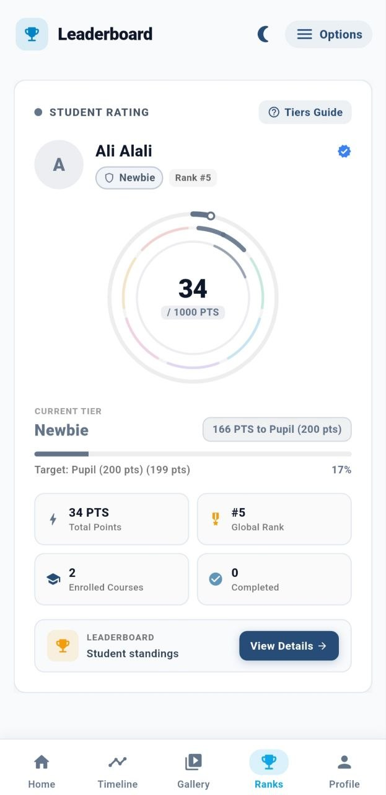
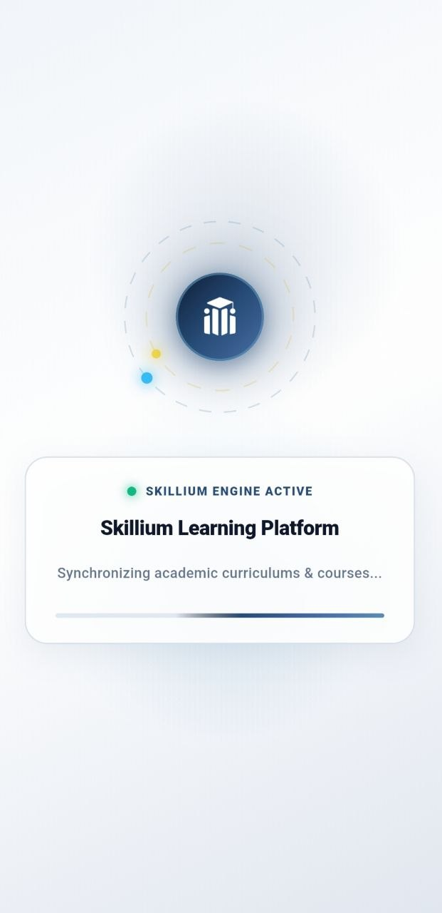

 

### Learning, structured for progress.

Skillium is a full-featured educational platform built to manage the complete academic journey—from structured curricula and sequential lessons to assessments, progress ranks, and private student–tutor meetings.

---

## Product overview

Skillium brings students, tutors, and administrators into one coordinated learning environment. The platform enforces progression rules rather than simply displaying content: exam outcomes control what a learner can access next, failed attempts trigger guided retry workflows, and every student can receive a secure private meeting link.

The experience is designed around a simple principle: **progress should be visible, earned, and actionable.**

## The learning loop

## Product tour

### The academy

Browse academic curricula, discover courses, meet verified tutors, and move between the core areas of the learning experience.

  

### Progress that students can understand

The student profile turns learning activity into a clear progression system with enrolled tracks, XP, tier status, exam history, and resumable course timelines.

  

### Motivation through visible achievement

Leaderboard tiers, total points, completion counts, and global rank give learners an immediate view of where they stand and what comes next.

  

### A focused launch experience

The animated launch state introduces the platform while academic curricula and courses are synchronized.

## Core capabilities

- **Multi-role authorization** — dedicated permissions and workflows for students, tutors, and administrators.
- **Structured academic content** — curricula, courses, lectures, and assessments managed through a unified system.
- **Sequential lesson access** — learning material unlocks according to completion and exam outcomes.
- **Assessment-aware progression** — successful results advance the learner; unsuccessful results activate a controlled retry path.
- **Student progress system** — XP, tiers, ranks, enrolled tracks, and completion indicators make progress easy to follow.
- **Private tutor meetings** — secure, student-specific meeting links protect one-to-one academic sessions.
- **Documented REST APIs** — designed to support web, mobile, and administrative clients.
- **Responsive experience** — product flows remain clear across mobile and larger screens.

## Platform roles

### Student

Enrolls in learning tracks, follows sequential lessons, completes assessments, monitors XP and rank, and joins private meetings.

### Tutor

Delivers academic content, manages learning material, supports students, and coordinates protected one-to-one sessions.

### Administrator

Manages users, roles, curricula, courses, assessments, progression rules, and platform-wide academic operations.

## Engineering highlights

- Designed authorization around multiple academic roles instead of a single generic user model.
- Modeled lesson availability as a progression state controlled by assessment results.
- Created retry workflows that preserve learning continuity after unsuccessful exam attempts.
- Separated platform capabilities behind documented REST endpoints for multiple client applications.
- Treated meeting access as private student data rather than a shared public resource.

## Project status

Skillium is an active portfolio project with a live demonstration available for product exploration.

[**Launch Skillium ↗**](https://portfolio-lime-eight-cb5c5ameei.vercel.app/)

## Source code

This repository is a **public product showcase**. The production source code, infrastructure configuration, credentials, and private project documentation are intentionally not included.

The screenshots and product materials in this repository are provided for portfolio presentation. All rights are reserved.

---

### Built by Saad Rimeh

PRIVATE ENGINEERING // PUBLIC PRODUCT STORY

